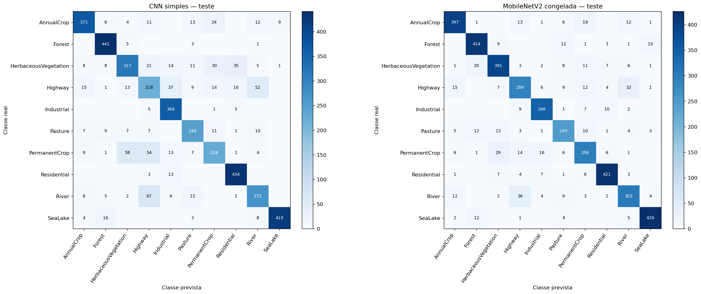

# Classificação de uso e cobertura do solo com EuroSAT

Projeto acadêmico de Visão Computacional que compara duas abordagens para classificar recortes RGB do EuroSAT em dez classes de uso e cobertura do solo:

- uma CNN simples treinada do zero;
- uma MobileNetV2 pré-treinada no ImageNet, com base convolucional congelada.

O protocolo usa F1 macro como métrica principal, divisão estratificada fixa de 70%/15%/15% e semente mestre 42. A escolha dos candidatos e checkpoints foi feita exclusivamente no conjunto de validação. O teste foi acessado somente após o congelamento das decisões experimentais.

## Principais resultados

Resultados sobre 4.050 imagens do conjunto de teste:

| Modelo | Acurácia | F1 macro | NLL média | Treinamento registrado |
|---|---:|---:|---:|---:|
| CNN simples | 0,8175 | 0,8082 | 0,5069 | 327,81 s |
| MobileNetV2 congelada | **0,8721** | **0,8672** | **0,3884** | 367,06 s |

A MobileNetV2 apresentou vantagem descritiva de 5,46 pontos percentuais em acurácia e 5,90 pontos percentuais em F1 macro. Isso não estabelece superioridade estatística: foram realizadas duas tentativas formais da CNN e uma da MobileNetV2, sob uma única divisão e uma única semente.

Os tempos de treinamento também são apenas descritivos. As duas execuções selecionadas utilizaram Tesla T4, mas a CNN foi treinada com TensorFlow 2.21.0 e a MobileNetV2 com TensorFlow 2.20.0.



## Dataset

Foi utilizada a distribuição RGB v2 do EuroSAT, baseada em imagens Sentinel-2:

- 27.000 imagens JPEG RGB de 64 × 64;
- 10 classes;
- arquivo `EuroSAT_RGB.zip` com 94.658.721 bytes;
- MD5 oficial e verificado: `f46e308c4d50d4bf32fedad2d3d62f3b`;
- fonte: [Zenodo — EuroSAT v2](https://doi.org/10.5281/zenodo.7711810).

O dataset bruto não integra o repositório. O notebook faz o download a partir da fonte oficial quando o ZIP validado ainda não está disponível na raiz configurada.

## Metodologia

1. Auditoria integral das imagens, formatos, dimensões, legibilidade e duplicatas.
2. Divisão estratificada e determinística em 18.900 imagens de treino, 4.050 de validação e 4.050 de teste.
3. Validação técnica do pipeline, dos checkpoints e da recarga dos modelos.
4. Seleção de cada candidato por F1 macro de validação, com desempate por loss e época.
5. Avaliação final única no teste, com métricas globais e por classe, matrizes de confusão e análise determinística de erros.

As imagens permaneceram em 64 × 64 e não foi aplicado augmentation. Os dois modelos utilizaram Adam com taxa inicial de aprendizado 0,001, lote 64, até 20 épocas e parada antecipada com paciência de cinco épocas.

## Estrutura

```text
.
├── notebooks/
│   └── EuroSAT_Trabalho_PAI.ipynb
├── src/
│   └── stage3_audit.py
├── configs/
│   ├── cnn_run_config.json
│   ├── environment.json
│   ├── mobilenetv2_run_config.json
│   └── split_config.json
├── results/
│   ├── figures/
│   ├── error_analysis.json
│   ├── error_examples.csv
│   ├── delivery_verification.json
│   ├── evaluation_protocol.json
│   ├── final_summary.json
│   ├── model_comparison.csv
│   └── per_class_metrics.csv
├── .gitignore
├── README.md
└── requirements.txt
```

## Execução no Google Colab

1. Copie o conteúdo do repositório para uma pasta persistente no Google Drive.
2. Abra `notebooks/EuroSAT_Trabalho_PAI.ipynb` no Colab.
3. Selecione uma GPU T4 quando houver disponibilidade.
4. Execute a primeira célula de ambiente.
5. Antes da célula **Persistência no Google Drive**, crie a pasta genérica `EuroSAT_Project` na raiz do Drive ou defina outra raiz:

```python
import os
os.environ["EUROSAT_PROJECT_DIR"] = "/content/drive/MyDrive/EuroSAT_Project"
```

6. Garanta que `src/stage3_audit.py` esteja sob essa raiz e execute as células em ordem.

Não grave IDs de pastas, links privados, tokens ou caminhos pessoais no notebook. A variável `EUROSAT_PROJECT_DIR` deve ser configurada somente no ambiente de execução.

## Níveis de reprodução

### Consulta da execução registrada

O notebook entregue contém as saídas reais das 23 células de código, incluindo curvas, tabelas, matrizes, análise de erros e resumo final.

### Recarga dos artefatos

A recarga dos dois checkpoints, a recomputação das métricas e figuras e a equivalência das predições foram verificadas em uma sessão reiniciada do Colab. Para repetir esse nível de verificação, é necessário restaurar os diretórios `artifacts/stage5_cnn_selection/` e `artifacts/stage6_mobilenetv2/` na raiz configurada.

Checkpoints `.keras`, backups, predições completas e o dataset não são versionados no GitHub. Esses arquivos permanecem como artefatos da execução acadêmica.

### Novo treinamento

A consolidação final não repetiu os treinamentos. Uma repetição integral deve ser tratada como nova execução formal, registrar novas versões, tempos e hashes e não sobrescrever os resultados entregues. Mesmo com semente fixa, não há garantia de equivalência bit a bit entre versões de biblioteca ou hardware.

## Limitações

- Uma única divisão e uma única semente não sustentam inferência estatística de superioridade.
- A divisão por imagem não comprova generalização para regiões geográficas inéditas.
- Arquitetura, inicialização e regime de treinamento variam entre os modelos; o desenho não isola somente o efeito do ImageNet.
- Os escores softmax não foram calibrados.
- O teste pertence ao próprio EuroSAT e não é um conjunto externo independente.
- O estudo utiliza somente RGB e não as 13 bandas multiespectrais do Sentinel-2.
- Os tempos registrados não constituem benchmark controlado.

## Referências

- Helber, P.; Bischke, B.; Dengel, A.; Borth, D. *EuroSAT: A Novel Dataset and Deep Learning Benchmark for Land Use and Land Cover Classification*. [DOI: 10.1109/JSTARS.2019.2918242](https://doi.org/10.1109/JSTARS.2019.2918242).
- [EuroSAT RGB v2 no Zenodo](https://doi.org/10.5281/zenodo.7711810).
- [Repositório EuroSAT dos autores](https://github.com/phelber/EuroSAT).
- [TensorFlow — Transfer learning and fine-tuning](https://www.tensorflow.org/tutorials/images/transfer_learning).
- [TensorFlow — MobileNetV2](https://www.tensorflow.org/api_docs/python/tf/keras/applications/MobileNetV2).
- [scikit-learn — F1 score](https://scikit-learn.org/1.6/modules/generated/sklearn.metrics.f1_score.html).

## Licença

Nenhuma licença para o código deste repositório foi definida. Os dados EuroSAT e Sentinel-2 permanecem sujeitos aos termos informados por suas fontes oficiais.
